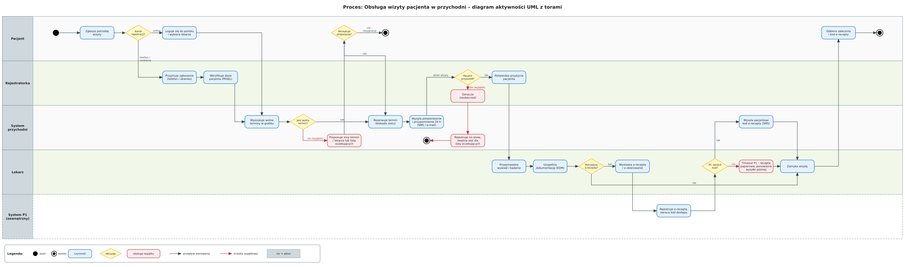

# Model procesu biznesowego

Jako główny proces wybraliśmy obsługę wizyty pacjenta, od momentu kiedy pacjent chce się umówić, do zakończenia wizyty u lekarza. Proces jest narysowany jako diagram aktywności UML z torami dla każdego aktora.

Pliki:
- `diagramy/proces-biznesowy.drawio` - plik źródłowy
- `diagramy/proces-biznesowy.png` - obraz

## Opis procesu

Pacjent może umówić się na dwa sposoby: przez portal internetowy albo dzwoniąc lub przychodząc do rejestracji. Przy zapisie telefonicznym rejestratorka najpierw sprawdza dane pacjenta po numerze PESEL.

Następnie system szuka wolnych terminów. Jeśli jest wolny termin, system go rezerwuje i wysyła pacjentowi potwierdzenie. Dzień przed wizytą wysyłane jest przypomnienie.

W dniu wizyty rejestratorka potwierdza, że pacjent przyszedł. Lekarz przeprowadza badanie i uzupełnia dokumentację. Jeśli pacjent potrzebuje leków, lekarz wystawia e-receptę, która trafia do systemu P1. P1 zwraca kod, a nasz system wysyła go pacjentowi SMS-em. Na koniec lekarz zamyka wizytę.

## Decyzje w procesie

- jakim kanałem pacjent się zapisuje (online czy telefonicznie / osobiście)
- czy jest wolny termin
- czy pacjent akceptuje inny termin albo listę oczekujących
- czy pacjent przyszedł na wizytę
- czy potrzebna jest e-recepta
- czy P1 zwrócił kod recepty

## Sytuacje wyjątkowe

Na diagramie zaznaczone są na czerwono.

1. Brak wolnego terminu - system proponuje inny termin, innego lekarza albo zapis na listę oczekujących. Jak pacjent się nie zgodzi, proces się kończy.
2. Pacjent nie przyszedł - rejestratorka zaznacza nieobecność, a system zwalnia termin dla osób z listy oczekujących.
3. System P1 nie odpowiada - lekarz wystawia receptę papierową, a system próbuje wysłać e-receptę ponownie później.
