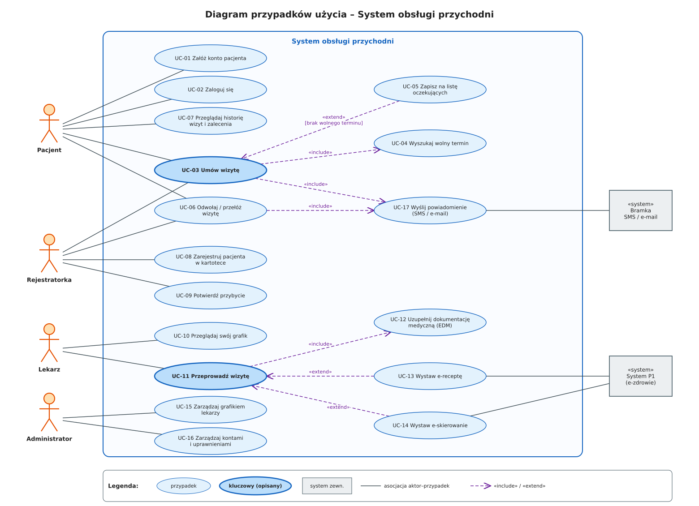

# Przypadki użycia

Pliki:
- `diagramy/przypadki-uzycia.drawio` - plik źródłowy
- `diagramy/przypadki-uzycia.png` - obraz

## Lista przypadków użycia

| Nr | Nazwa | Aktor |
|---|---|---|
| UC-01 | Załóż konto pacjenta | Pacjent |
| UC-02 | Zaloguj się | Pacjent |
| UC-03 | Umów wizytę | Pacjent, Rejestratorka |
| UC-04 | Wyszukaj wolny termin | (część UC-03) |
| UC-05 | Zapisz na listę oczekujących | Pacjent |
| UC-06 | Odwołaj / przełóż wizytę | Pacjent, Rejestratorka |
| UC-07 | Przeglądaj historię wizyt | Pacjent |
| UC-08 | Zarejestruj pacjenta w kartotece | Rejestratorka |
| UC-09 | Potwierdź przybycie | Rejestratorka |
| UC-10 | Przeglądaj swój grafik | Lekarz |
| UC-11 | Przeprowadź wizytę | Lekarz |
| UC-12 | Uzupełnij dokumentację medyczną | (część UC-11) |
| UC-13 | Wystaw e-receptę | Lekarz, System P1 |
| UC-14 | Wystaw e-skierowanie | Lekarz, System P1 |
| UC-15 | Zarządzaj grafikiem lekarzy | Administrator |
| UC-16 | Zarządzaj kontami | Administrator |
| UC-17 | Wyślij powiadomienie | Bramka SMS / e-mail |

Najważniejsze są UC-03 i UC-11, bo bez nich przychodnia nie może działać. Opisaliśmy je poniżej.

## UC-03 Umów wizytę

**Aktorzy:** Pacjent, Rejestratorka

**Warunki początkowe:** pacjent jest zalogowany albo rejestratorka wybrała go z kartoteki. Lekarz ma ustawiony grafik.

**Warunki końcowe:** wizyta jest zapisana, termin jest zajęty, pacjent dostał potwierdzenie.

**Scenariusz główny:**
1. Pacjent wybiera specjalizację i ewentualnie konkretnego lekarza.
2. System pokazuje wolne terminy.
3. Pacjent wybiera termin.
4. System pokazuje podsumowanie: lekarz, data, godzina, gabinet.
5. Pacjent potwierdza.
6. System sprawdza, czy termin jest nadal wolny, i zapisuje wizytę.
7. System wysyła potwierdzenie SMS i e-mail oraz ustawia przypomnienie na dzień przed.

**Scenariusze alternatywne:**
- 2a. Nie ma wolnych terminów. System proponuje inny termin albo innego lekarza. Pacjent może też zapisać się na listę oczekujących (UC-05).
- 5a. Pacjent ma już wizytę u tego lekarza. System proponuje przełożenie tamtej wizyty.
- 6a. Ktoś w międzyczasie zajął ten termin. System pokazuje komunikat i wraca do listy terminów.
- 7a. SMS nie został wysłany. Wizyta i tak jest zapisana, pacjent dostaje maila, a SMS jest wysyłany ponownie później.

## UC-11 Przeprowadź wizytę

**Aktorzy:** Lekarz, System P1

**Warunki początkowe:** lekarz jest zalogowany, rejestratorka potwierdziła, że pacjent przyszedł.

**Warunki końcowe:** wizyta ma status "odbyta", dokumentacja jest zapisana.

**Scenariusz główny:**
1. Lekarz wybiera pacjenta z listy na dziś.
2. System pokazuje kartę pacjenta i historię wcześniejszych wizyt.
3. Lekarz przeprowadza wywiad i badanie.
4. Lekarz wpisuje wywiad, wynik badania, rozpoznanie i zalecenia (UC-12).
5. Jeśli trzeba, lekarz wystawia e-receptę (UC-13) albo e-skierowanie (UC-14).
6. Lekarz klika "Zakończ wizytę".
7. System sprawdza, czy wszystkie wymagane pola są uzupełnione, i zamyka wizytę.
8. Pacjent widzi zalecenia i kody recept na swoim koncie.

**Scenariusze alternatywne:**
- 5a. System P1 nie odpowiada. Lekarz dostaje komunikat i wystawia receptę papierową, a system próbuje wysłać e-receptę ponownie.
- 7a. Brakuje rozpoznania albo zaleceń. System zaznacza puste pola i nie pozwala zamknąć wizyty.
- 3a. Pacjent wyszedł przed badaniem. Lekarz oznacza wizytę jako przerwaną.
