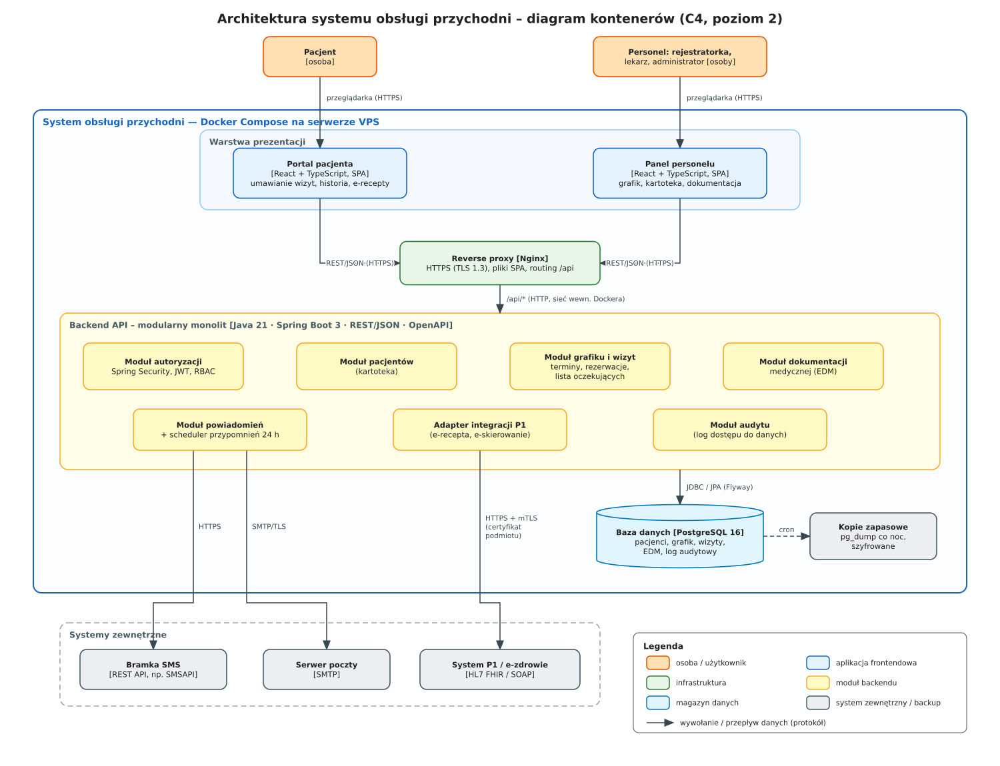

# Architektura systemu

Pliki:
- `diagramy/architektura.drawio` - plik źródłowy
- `diagramy/architektura.png` - obraz

## Opis

System to aplikacja webowa podzielona na frontend, backend i bazę danych.

**Frontend** składa się z dwóch aplikacji: portalu dla pacjentów i panelu dla pracowników przychodni. Rozdzieliliśmy je, bo pacjenci i personel korzystają z zupełnie innych funkcji, a pracownicy mają dodatkowo logowanie dwuetapowe.

**Nginx** przyjmuje wszystkie połączenia z zewnątrz przez HTTPS, udostępnia pliki frontendu i przekazuje zapytania do API.

**Backend** to jedna aplikacja w Spring Boot, ale podzielona na moduły:
- autoryzacja - logowanie i role użytkowników
- pacjenci - kartoteka
- grafik i wizyty - terminy, rezerwacje, lista oczekujących
- dokumentacja medyczna
- powiadomienia - SMS, maile i przypomnienia
- integracja z P1 - e-recepty i e-skierowania
- audyt - zapis, kto przeglądał dane medyczne

Wybraliśmy jedną aplikację zamiast mikroserwisów, bo jesteśmy małym zespołem i łatwiej będzie to wdrożyć i testować. Podział na moduły pozwoli w razie potrzeby wydzielić któryś z nich później.

**Baza danych** to PostgreSQL. Codziennie robiona jest kopia zapasowa.

**Systemy zewnętrzne:** P1 do e-recept, bramka SMS i serwer pocztowy. Jeśli któryś z nich nie działa, system zapisuje zadanie i próbuje ponownie później, żeby nie blokować pracy przychodni.

Całość uruchamiamy w kontenerach Docker na serwerze VPS.
